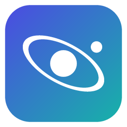

<p align="center"></p>

<h1 align="center">OmniContext</h1>

<p align="center"><b>One memory for every AI agent, on every device.</b><br/>
Claude Code, Claude Desktop, ChatGPT, OpenAI Codex, Cursor, Gemini CLI and any MCP client, on any of your machines, know who you are, what you're working on, and where you left off. Start in Claude, resume in Codex.</p>

<p align="center">
<a href="https://github.com/aaryanbindage/omnicontext/releases/latest">Download (Mac · Windows · Linux)</a> ·
<a href="#claude-code-plugin">Claude Code plugin</a> ·
<a href="#openai-codex">Codex plugin</a> ·
<a href="#claude-desktop--other-mcp-clients">MCP server</a> ·
<a href="https://aaryanbindage.github.io/omnicontext/">Website</a>
</p>

<p align="center">
<a href="https://www.npmjs.com/package/@aaryanbindage/omnicontext"></a>
<a href="https://github.com/aaryanbindage/omnicontext/actions/workflows/ci.yml"></a>
<a href="LICENSE"></a>
</p>

---

```text
You (on your laptop):  continue my game project
Claude:                Resuming Starfall (the Godot space roguelike). Last session on your desktop
                       you finished the enemy state machine; next up is the boss fight timings…
```

## What it does

- **Knows you.** A profile (role, preferences, tools, facts) shared with every session. Claude adds to it when you tell it something lasting (`remember`).
- **Knows your projects.** Name them once, give them nicknames, and "my game project", "the website" or "that bot" resolve to the right one in any session. Each project keeps notes, its repo, and its folder on each device.
- **Resumes across devices.** `/omnicontext:handoff` saves a self-contained summary and next steps, plus the git branch and commit and any uncommitted or unpushed work. On another machine, `/omnicontext:resume` picks it up, opens the project's folder on that device, and tells you how to get the checkout to the same state.
- **Inbox for quick thoughts.** Dictate on your Apple Watch, or run `omnicontext capture "…"`. The next Claude session offers to file each one as a profile fact or a project note (`/omnicontext:inbox`).
- **Apple Watch app.** A standalone watchOS viewer that needs no iPhone. It shows open handoffs, projects and your profile, lets you mark handoffs done, and dictates captures. It talks straight to your private GitHub data repo. See [watch/](watch/).
- **Knowledge graph, Obsidian-style.** The desktop app's Graph tab draws everything in memory: you, projects, tags, devices, handoffs, facts, inbox and `[[Topics]]`. Projects link through shared tags and whenever one names another. Drag, zoom, search and filter, and click a node to see its connections. Claude can walk it with the `related` tool ("what else uses Godot?"), and the watch app can browse it too.
- **Forgets on request.** "That's not true anymore" → `forget`.
- **Syncs without a cloud service.** Your memory is a folder of plain Markdown and JSON files (`~/.omnicontext`) synced through a **private git repo you own**. Nothing goes to a third-party server.
- **Shared by all your agents.** Claude Code and Codex plugins inject your context at session start; Claude Desktop, Cursor, Gemini CLI, VS Code, Windsurf and Zed connect to the same MCP server. A handoff saved in Claude can be resumed in Codex (and vice versa), and each one records which agent wrote it. `omnicontext install all` wires up every agent it finds.
- **Works everywhere.** A desktop app for Mac, Windows and Linux, a CLI, and an Apple Watch app.

## Install

### Desktop app (Mac · Windows · Linux)

Download from **[Releases](https://github.com/aaryanbindage/omnicontext/releases/latest)**:

| OS | File |
|---|---|
| Windows | `OmniContext-Setup-x.y.z.exe` (installer) or `…-Windows-x64.zip` (portable) |
| macOS | `…-macOS-arm64.dmg` (Apple Silicon) / `…-macOS-x64.dmg` (Intel) |
| Linux | `…-Linux-x86_64.AppImage` / `…-Linux-amd64.deb` (x64), `…-Linux-arm64.AppImage` / `…-Linux-arm64.deb` (ARM64, e.g. Raspberry Pi 4/5) |

The app lets you edit your profile, projects and handoffs, set up sync, and connect Claude Code and Claude Desktop with one click. It stays in the tray and syncs in the background.

> macOS builds aren't notarized yet. If macOS says the app is damaged, run `xattr -cr /Applications/OmniContext.app`.

### Claude Code plugin

```text
/plugin marketplace add aaryanbindage/omnicontext
/plugin install omnicontext@omnicontext
```

Requires Node.js 18+. You get:

| | |
|---|---|
| **SessionStart hook** | injects your profile, project index, the current project, and open handoffs |
| **SessionEnd hook** | syncs your memory to your other devices |
| `/omnicontext:handoff [title]` | save the current work so it can be resumed anywhere |
| `/omnicontext:resume [project]` | continue the latest (or a named) handoff |
| `/omnicontext:remember <fact>` | remember something about you or a project |
| `/omnicontext:project [name aka nickname]` | register this folder as a project |
| `/omnicontext:sync` | sync now |
| MCP tools + skill | Claude resolves "my X project", saves notes and handoffs |

### OpenAI Codex

**Plugin** (skill + MCP server + SessionStart hook):

```bash
codex plugin marketplace add aaryanbindage/omnicontext
```

Then install **OmniContext** from the Plugins directory in Codex.

**Or just the MCP server and instructions** (Codex CLI, IDE extension and app all read `~/.codex/config.toml`):

```bash
npx -y @aaryanbindage/omnicontext install codex
```

This adds `[mcp_servers.omnicontext]` to `~/.codex/config.toml` and a short OmniContext section to `~/.codex/AGENTS.md`. Re-running it updates both in place.

### ChatGPT

ChatGPT (web, desktop and mobile) connects to MCP servers by URL, so OmniContext runs an HTTP endpoint on your computer and shares it through a Cloudflare quick tunnel:

- **Desktop app:** **Connect agents → ChatGPT → Start ChatGPT link**, then copy the link.
- **CLI:** `npx -y @aaryanbindage/omnicontext serve --tunnel` prints the link. It uses `cloudflared` if installed, otherwise downloads it via npm.

In ChatGPT, open **Settings → Apps & Connectors → Advanced**, turn on **Developer mode**, then **Create** a connector with that URL and **No authentication**. Enable it in a chat (or under the + menu) and ask "what do you know about my projects?". Developer mode availability depends on your ChatGPT plan.

The link contains a random secret (`/mcp/<secret>`), and anyone with it can read and write your memory, so keep it private; `omnicontext serve --rotate` (or **New secret**) replaces it. Quick-tunnel links change each time the tunnel starts, and the link only works while your computer is on. For a permanent address, put `omnicontext serve --port 8787` behind your own HTTPS proxy or named tunnel and pass `--public https://your.host`.

### Every agent at once

```bash
npx -y @aaryanbindage/omnicontext install all     # Claude Code, Claude Desktop, Codex, Cursor, Gemini CLI — whichever are installed
```

Or one at a time: `install codex`, `install cursor`, `install gemini`, `install claude-code`, `install claude-desktop`. The desktop app has the same buttons under **Connect agents**.

### Claude Desktop & other MCP clients

**One click:** download `omnicontext.mcpb` from Releases and open it with Claude Desktop.
You can also use the desktop app (**Connect agents → Install**) or run `npx @aaryanbindage/omnicontext install claude-desktop`.

**Manually** (Claude Desktop, Cursor, Windsurf, VS Code, Zed, Cline and others):

```json
{
  "mcpServers": {
    "omnicontext": { "command": "npx", "args": ["-y", "@aaryanbindage/omnicontext", "mcp"] }
  }
}
```

### CLI

```bash
npm i -g @aaryanbindage/omnicontext
omnicontext project add "Starfall" --alias "my game" --tag godot --desc "2D space roguelike" --path .
omnicontext resolve "my game project"
omnicontext remember "Prefers TypeScript and short answers"
omnicontext forget "TypeScript"
omnicontext capture "try a grappling hook in level 3" --project starfall
omnicontext export backup.json     # everything in one file; import with: omnicontext import backup.json
omnicontext sync --github          # one-time: create a private repo and sync
```

## Sync your devices

On your **first** device:

```bash
omnicontext sync --github                  # needs the GitHub CLI (gh auth login); creates <you>/omnicontext-data (private)
# or
omnicontext sync --remote <any git url you own>
```

On **every other** device, connect the same repo:

```bash
omnicontext sync --remote https://github.com/<you>/omnicontext-data.git
omnicontext device "MacBook"               # optional: a friendly device name
```

You can do the same from the desktop app's **Sync & devices** tab. After that, sync runs on its own: at the start and end of each Claude Code session, a few seconds after the MCP server makes a change, and every few minutes while the desktop app is open. Each record is its own file, so two devices rarely conflict. When they do, the local version wins, and git history keeps everything.

## MCP tools

| Tool | Purpose |
|---|---|
| `get_context` | Full briefing: profile, projects, open handoffs (for clients without hooks) |
| `get_profile` / `update_profile` / `remember` / `forget` | Read and update what Claude knows about you |
| `list_projects` / `get_project` / `upsert_project` / `add_project_note` | Manage projects, nicknames, per-device folders, notes |
| `resolve_project` | "my game project" → the matching project, ranked |
| `save_handoff` / `list_handoffs` / `resume_handoff` / `complete_handoff` | Cross-device resume |
| `capture` / `list_inbox` / `file_inbox` | Quick captures (for example from the watch) and filing them |
| `related` | Walk the knowledge graph from a project, #tag, device or [[topic]] |
| `search_memory` | Search the profile, notes, handoffs, and inbox |
| `sync_now` | Push and pull with your other devices |

It also provides the prompts `resume` and `handoff`, and the resources `omnicontext://profile`, `omnicontext://context` and `omnicontext://projects/{slug}`.

## Data format

```text
~/.omnicontext/
  profile.md               # you — edit freely
  projects/starfall.json   # name, aliases, tags, description, repo, paths per device, notes
  handoffs/<id>.json       # title, summary, next steps, files, device, status, git state
  inbox/<id>.json          # quick captures waiting to be filed
  snapshot.json            # everything above in one file, written on sync (read by the watch app)
  local.json               # this device only (name, sync prefs) — not synced
```

Set `OMNICONTEXT_HOME` to use a different folder. You can also put the folder in Dropbox, iCloud or OneDrive instead of using git sync.

## Privacy

Everything stays on your machines and in the git remote you choose. OmniContext has no server, no telemetry, and no account. Don't store secrets in it. The instructions it gives Claude say the same.

## Development

```bash
npm install
npm test
npm run build          # bundles dist/omnicontext.mjs (used by the plugin, the app, and npm)
cd app && npm install && npm start     # run the desktop app
```

Releases: push a `v*` tag. GitHub Actions builds the Windows, macOS and Linux apps and the `.mcpb` bundle, and publishes to npm.

## License

MIT © aaryanbindage
