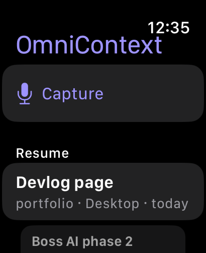
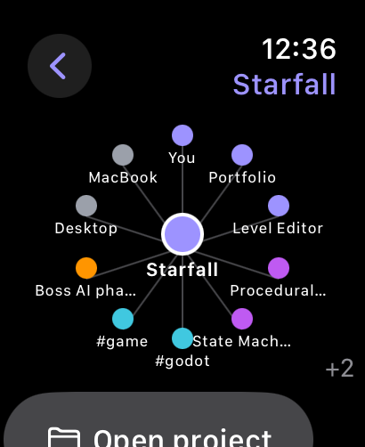
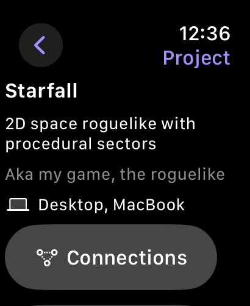
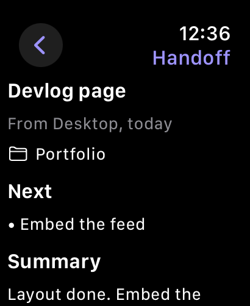

# OmniContext for Apple Watch

A standalone watchOS app (no iPhone app, and the phone doesn't need to be nearby). It talks straight to GitHub over the watch's own Wi-Fi or cellular connection and reads the `snapshot.json` that `omnicontext sync` keeps in your private data repo.

- **Resume**: open handoffs, with next steps, summary and the git branch they were left on. Mark them done.
- **Projects**: descriptions, nicknames, notes and handoffs.
- **About me**: your profile.
- **Capture**: dictate a thought (or a note on a project). It lands in `inbox/` in your data repo, and the next Claude session on any device offers to file it as a fact or project note.
- **Graph**: walk your knowledge graph one node at a time. Start from you or from a project's **Connections**, and tap any linked project, tag, topic or handoff to move there.
- Works offline from the last download.

| Home | Graph | Project | Handoff |
|---|---|---|---|
|  |  |  |  |

CI builds the app on every change, runs it in the watchOS simulator with sample data, and takes these screenshots (`.github/workflows/watch.yml`).

Requirements: OmniContext 0.2.0+ syncing to a **GitHub** repo (`omnicontext sync --github`), watchOS 10+, and a Mac with Xcode 15+ to install it.

## 1. Create a GitHub App for sign-in (once, about a minute)

The watch signs in with GitHub's device flow: it shows a short code, and you enter it on any phone or computer. That needs a client ID.

1. Go to <https://github.com/settings/apps/new>.
2. Name: anything, e.g. `OmniContext Watch (yourname)`. Homepage URL: `https://github.com/aaryanbindage/omnicontext`.
3. Tick **Enable Device Flow**. Untick **Webhook → Active**. You don't need a callback URL.
4. Under **Permissions → Repository permissions**, set **Contents** to **Read and write**. Leave everything else at No access.
5. Under **Where can this GitHub App be installed?**, choose **Only on this account**, then **Create GitHub App**.
6. On the app's page, under **Optional features**, opt out of **User-to-server token expiration**, so the watch stays signed in.
7. Click **Install App** and install it on **only** your `omnicontext-data` repo.
8. Copy the **Client ID** (it starts with `Iv`).

The watch can then reach only that one repo, and only its files.

> You can use a classic OAuth App with Device Flow enabled instead. That works too, but it asks for access to all your repos.

## 2. Build and install

```sh
brew install xcodegen
cd watch
cat > Local.xcconfig <<EOF
GITHUB_CLIENT_ID = Iv23li...your id...
DEVELOPMENT_TEAM = YOURTEAMID
WATCH_BUNDLE_ID = com.yourname.omnicontext.watch
EOF
xcodegen
open OmniContextWatch.xcodeproj
```

In Xcode, pick your watch as the run destination and press Run. A free Apple ID works: add it in Xcode → Settings → Accounts. Apps signed with a free account expire after 7 days and need re-running from Xcode. A paid developer account lasts a year, and with one you could also ship it through TestFlight.

## 3. Sign in on the watch

Open OmniContext on the watch, tap **Sign in with GitHub**, and enter the code shown at github.com/login/device on any device. The data repo defaults to `<you>/omnicontext-data`, and you can change it in Settings.
